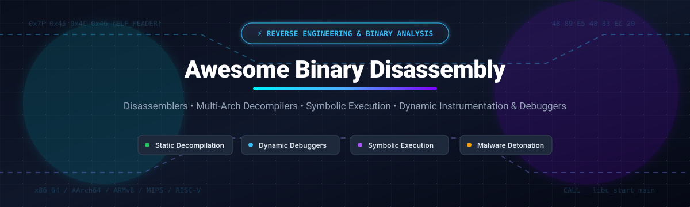
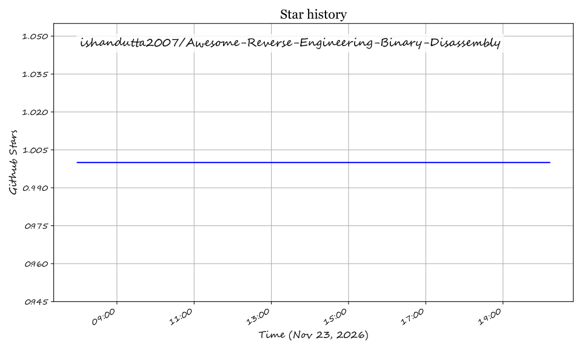

# Awesome Reverse Engineering & Binary Disassembly 🔍⚡

 

 

**Curated list of commercial SaaS/proprietary suites and top open-source software reverse engineering (SRE) frameworks, multi-architecture decompilers, interactive disassemblers, dynamic binary instrumentation engines, symbolic execution tools, and malware sandboxes.**

*Disassembly • Decompilation • Symbolic Execution • Dynamic Instrumentation • Malware Detonation • Binary Diffing*

**Last updated: November 2026**

---

## 📑 Table of Contents
- [📌 Sector Overview & Market Dynamics](#-sector-overview--market-dynamics)
- [💼 SaaS & Commercial Platforms](#-saas--commercial-platforms)
- [🔓 Open-Source GitHub Projects](#-open-source-github-projects)
- [🛠️ Frameworks for Building Custom Binary Analysis Pipelines](#️-frameworks-for-building-custom-binary-analysis-pipelines)
- [🤝 How to Contribute](#-how-to-contribute)
- [💖 Support](#-support)
- [⭐ Star History](#--star-history)
- [⚠️ Disclaimer](#️-disclaimer)

---

## 📌 Sector Overview & Market Dynamics

The global software reverse engineering and binary analysis sector is estimated at **$1.63 billion to $2.04 billion in 2024–2025**, projected to surpass **$5.4 billion by 2034** with a robust **CAGR of ~17.2%**, driven by escalating zero-day exploits, software supply chain mandates (SBOM/CRA), firmware security audits, and critical infrastructure defense. The market dynamics are **moderately fragmented yet top-heavy with established category champions**: enterprise buyers and defense agencies rely heavily on entrenched standards (Hex-Rays IDA Pro, VMRay), while modern challengers (Vector 35 Binary Ninja, RevEng.AI) and sovereign open-source alternatives (NSA Ghidra) prevent absolute winner-take-all capture, fostering a dual ecosystem of commercial enterprise platforms and community-driven open-source tooling.

---

## 💼 SaaS & Commercial Platforms

*Commercial enterprise software reverse engineering suites, sandboxes, and cloud binary intelligence platforms sorted in descending order of company size (revenue / enterprise valuation / institutional scale).*

| Tool / Platform | Valuation / Company Scale | Starting Tier Pricing | Free Tier / Free Trial Limits | Key Capabilities & Architecture Support |
| :--- | :--- | :--- | :--- | :--- |
| **[VMRay Analyzer](https://vmray.com)** | **$50M+ est. valuation** (~$15M–$25M ARR, $44M+ funding raised) | **$10,000 / year** (entry commercial enterprise quote) | **30-day enterprise trial** (request through sales; full cloud sandboxing & automated detonation features) | Agentless hypervisor-level automated malware detonation, deep API function tracing, and anti-evasion threat intelligence. |
| **[IDA Pro & Hex-Rays / IDA Cloud](https://hex-rays.com)** | **€50M–€100M est. valuation** (acquired by Smartfin/SFPIM; €20M+ revenue) | **$365 / year** (IDA Home single-arch); **$1,099 / year** (IDA Pro Essential) | **Perpetual Free Edition** (IDA Free: restricted to non-commercial use, x86/x64 only, cloud decompiler, no plugins) | The industry gold standard interactive disassembler and decompiler supporting 60+ CPU families, Lumina metadata server, and IDC/Python APIs. |
| **[RevEng.AI](https://reveng.ai)** | **$35M–$50M est. valuation** ($19.5M+ total venture funding; Series A backed by NATO Innovation Fund & In-Q-Tel) | **$250 / user / month** (billed annually for team tier; custom defense quote) | **Free Community Portal Access** (limited daily sample hashes, basic AI function embeddings, and maliciousness scoring) | AI foundation models (*BinNet*, *WilBERT*) for semantic code similarity search, function symbol recovery, and cross-architecture binary diffing. |
| **[Joe Sandbox Cloud](https://joesecurity.org)** | **$10M–$25M est. valuation** (est. $3M–$7M revenue; leading bootstrapped Swiss sandbox provider) | **$500 / month** (billed annually for Joe Sandbox Cloud Pro) | **Perpetual Free Community Tier** (Joe Sandbox Cloud Basic: max 10 analyses/month, 2-min interactive session, public reports only) | Multi-OS deep behavioral malware analysis (Windows, Linux, macOS, Android), memory dump inspection, and YARA rule matching. |
| **[Binary Ninja (Vector 35)](https://binary.ninja)** | **$10M–$20M est. valuation** (est. $2M–$5M ARR; funded by In-Q-Tel & bootstrapped) | **$199 one-time** (Non-Commercial); **$1,799 / seat** (Commercial Named License) | **Perpetual Free Edition & Web Cloud** (Binary Ninja Free desktop: x86/x64/ARMv7/ARMv8, no headless API/plugins; Cloud: ELF/PE/Mach-O only) | Next-generation reverse engineering platform featuring layered Intermediate Languages (BNIL/LLIL/MLIL/HLIL), native modern GUI, and collaborative enterprise server. |
| **[JEB Decompiler (PNF Software)](https://pnfsoftware.com)** | **$5M–$15M est. valuation** (est. $1M–$3M revenue; bootstrapped private enterprise) | **$140 / month** ($1,200/yr for JEB Android); **$2,000 / year** (JEB Pro multi-arch) | **Perpetual Free Community Edition** (JEB CE: non-commercial only, x86/x64 decompiler; Demo: 15-minute time-limited sessions, no saving) | Premier multi-architecture decompiler acclaimed for Android APK, DEX, and Dalvik bytecode analysis, ARM, MIPS, WebAssembly, and Ethereum smart contracts. |
| **[Hopper Disassembler](https://hopperapp.com)** | **$1M–$5M est. valuation** (est. $500K–$1.5M revenue; Cryptic Apps boutique) | **$99 one-time** (Personal license; $599 Computer multi-user license) | **Free Demo Mode** (30-minute maximum runtime session, saving and exporting disassemblies disabled, debugger disabled) | Dedicated disassembler, decompiler, and debugger for macOS, iOS, and Linux binaries targeting Apple Silicon (ARM64), x86/x64, and Mach-O files. |
| **[Dogbolt (Decompiler Explorer)](https://dogbolt.org)** | **Community Open Platform** (operated by decompiler-explorer org; community funded) | **$0 / month** (100% free community hosted web service) | **100% Free Public Access** (max 2MB binary upload limit per analysis, public web queues) | Online comparative decompiler explorer comparing simultaneous decompilation from Ghidra, Hex-Rays, Binary Ninja, angr, RetDec, and snowman. |

---

## 🔓 Open-Source GitHub Projects

*Curated top-tier open-source reverse engineering frameworks, decompilers, debuggers, and binary utilities sorted in descending order of GitHub stargazers.*

- **[Ghidra](https://github.com/NationalSecurityAgency/ghidra)**   
  Flagship software reverse engineering (SRE) suite developed by the NSA. Features a multi-architecture decompilation engine, collaborative server workflows, SLEIGH processor specification language, P-Code intermediate representation, and extensive Java/Python plugin APIs.

- **[ImHex](https://github.com/WerWolv/ImHex)**   
  Modern, feature-packed hex editor tailored specifically for reverse engineers and low-level programmers. Boasts a custom C-like pattern language for structural file parsing, built-in disassembler, math evaluator, entropy analyzer, and YARA integration.

- **[JADX](https://github.com/skylot/jadx)**   
  Dex to Java decompiler offering command-line and rich GUI interfaces. Facilitates instant decompilation of Android APK, DEX, AAR, and class bytecode files with deobfuscation and resource decoding.

- **[x64dbg](https://github.com/x64dbg/x64dbg)**   
  Premier open-source x64/x32 user-mode dynamic debugger for Microsoft Windows. Integrates Scylla import reconstruction, memory memory breakpoint handling, disassembly views, and an extensive C++/Python plugin ecosystem.

- **[ILSpy](https://github.com/icsharpcode/ILSpy)**   
  Standard open-source .NET assembly browser and decompiler. Decompiles C# assemblies back to high-fidelity source code with cross-platform support via ICSharpCode.Decompiler and Avalonia ILSpy.

- **[Radare2](https://github.com/radareorg/radare2)**   
  Ultra-portable, Unix-like command-line reverse engineering framework, disassembler, hex editor, dynamic debugger, and binary analyzer covering virtually every known CPU architecture and OS platform.

- **[Frida](https://github.com/frida/frida)**   
  Dynamic binary instrumentation toolkit for security researchers. Injects JavaScript/C hooks into native apps on Windows, macOS, Linux, iOS, Android, and QNX to observe and alter runtime logic in real time.

- **[Cutter](https://github.com/rizinorg/cutter)**   
  Free, user-friendly Qt-based GUI reverse engineering platform powered by Rizin. Integrates Ghidra's decompiler, disassembly graphing, hex editing, dynamic debugging, and Python scripting.

- **[Binwalk](https://github.com/ReFirmLabs/binwalk)**   
  Fast firmware extraction and reverse engineering tool engineered to scan raw binary images, detect embedded filesystems (SquashFS, CramFS, JFFS2), and extract compressed code blobs.

- **[dnSpyEx](https://github.com/dnSpyEx/dnSpy)**   
  Revived community fork of the renowned dnSpy .NET debugger and assembly editor. Allows live modification and debugging of compiled .NET assemblies directly inside memory without requiring original source code.

- **[pwndbg](https://github.com/pwndbg/pwndbg)**   
  Exploit development and binary reverse engineering framework for GDB. Replaces vanilla GDB with an informative terminal UI displaying registers, stack frames, heap allocations, and memory mappings.

- **[Unicorn Engine](https://github.com/unicorn-engine/unicorn)**   
  Lightweight multi-architecture CPU emulator framework based on QEMU. Emulates ARM, ARM64, MIPS, x86, SPARC, and RISC-V machine instructions with memory hooks and register tracing.

- **[angr](https://github.com/angr/angr)**   
  Python framework for analyzing binaries combining static analysis, symbolic execution, control-flow recovery, and automated vulnerability synthesis using the angr decompiler and Claripy SMT solver.

- **[Capstone Engine](https://github.com/capstone-engine/capstone)**   
  The industry's ultimate lightweight multi-platform, multi-architecture disassembly framework. Powers hundreds of security utilities with support for x86, ARM, ARM64, MIPS, PowerPC, SPARC, and RISC-V.

- **[RetDec](https://github.com/avast/retdec)**   
  Open-source retargetable machine-code decompiler based on LLVM. Recovers high-level C code from ELF, PE, Mach-O, COFF, and raw firmware binaries across x86, ARM, MIPS, and PowerPC.

- **[GEF (GDB Enhanced Features)](https://github.com/hugsy/gef)**   
  Modern Python extension for GDB aimed at dynamic binary reverse engineering, security researchers, and exploit developers with heap analysis and architecture visualization.

- **[capa](https://github.com/mandiant/capa)**   
  Open-source tool by Mandiant that automatically detects capabilities and intent in executable files (PE, ELF, Mach-O), mapping behaviors against the MITRE ATT&CK framework.

- **[pycdc (Decompyle++)](https://github.com/zrax/pycdc)**   
  High-performance C++ Python bytecode disassembler and decompiler capable of analyzing compiled `.pyc` files across Python versions up to Python 3.12+.

- **[Diaphora](https://github.com/joxeankoret/diaphora)**   
  The leading open-source program diffing engine implemented as an IDA Pro / Ghidra / Binary Ninja plugin for diffing patched and unpatched binaries to uncover vulnerability fixes.

- **[Triton DBA](https://github.com/JonathanSalwan/Triton)**   
  Dynamic Binary Analysis (DBA) framework providing taint analysis, dynamic symbolic execution (DSE), AST representations of instructions, and automated SMT constraint solving.

- **[uncompyle6](https://github.com/rocky/python-uncompyle6)**   
  Native Python cross-version decompiler translating Python byte-code back into equivalent Python source code, supporting legacy and modern Python releases.

- **[FLOSS (Mandiant)](https://github.com/mandiant/flare-floss)**   
  FLARE Obfuscated String Solver using advanced static analysis and emulation to automatically extract obfuscated strings, stackstrings, and tight-loop decoded artifacts from malware binaries.

- **[Rizin](https://github.com/rizinorg/rizin)**   
  UNIX-like reverse engineering framework and binary analysis tool focused on modularity, clean architecture, automated testing, and headless scripting pipelines.

- **[Dogbolt Decompiler Explorer](https://github.com/decompiler-explorer/decompiler-explorer)**   
  The full open-source web application behind dogbolt.org, allowing side-by-side multi-decompiler execution and output exploration in Docker.

- **[Keystone Engine](https://github.com/keystone-engine/keystone)**   
  Lightweight multi-platform, multi-architecture assembler framework supporting x86, ARM, ARM64, MIPS, PowerPC, and SPARC assembly with clean C/Python bindings.

- **[Reko Decompiler](https://github.com/uxmal/reko)**   
  Multi-architecture machine code decompiler written in C# designed to recover high-level source code from archaic and contemporary executable formats.

- **[APKiD](https://github.com/rednaga/APKiD)**   
  PEiD-style identifier for Android applications, detecting commercial packers, obfuscators, anti-debugging mechanisms, and third-party native libraries inside APK files.

- **[Quark-Engine](https://github.com/quark-engine/quark-engine)**   
  Trustworthy Android malware scoring system and behavioral inspection engine that extracts Dalvik bytecode opcodes to evaluate security risks and suspicious flows.

- **[Manalyze](https://github.com/JusticeRage/Manalyze)**   
  Static PE executable analyzer for Windows detecting malicious indicators, compiler origins, cryptographic algorithms, PE anomalies, and suspicious API imports.

- **[Gecko](https://github.com/ioncodes/gecko)**   
  Fast binary inspection utility built for low-level binary exploration, opcode decoding, and interactive disassembling.

---

## 🛠️ Frameworks for Building Custom Binary Analysis Pipelines

When building automated binary inspection infrastructure or CTF triage workflows, combine these complimentary components:

1. **Static Analysis & Decompilation**: Use **Ghidra** headless analysis or **Binary Ninja** Python API to parse control-flow graphs and decompile functions.
2. **Dynamic Instrumentation & Hooking**: Deploy **Frida** or **pwndbg** to intercept runtime function arguments, bypass anti-tamper logic, and extract decrypted memory segments.
3. **Automated Triage & Capabilities**: Execute **capa** and **FLOSS** to classify binary actions against the MITRE ATT&CK matrix and decode embedded strings.
4. **Binary Diffing & Patch Analysis**: Use **Diaphora** to identify modified functions between software versions to quickly detect security vulnerability fixes.
5. **Symbolic Execution**: Leverage **angr** or **Triton** to mathematically solve for hard-to-reach execution branches and uncover input sequences that trigger crashes.

---

## 🤝 How to Contribute

Contributions are warmly welcomed! To contribute:

1. 🍴 Fork the repository.
2. 🌿 Create a feature branch (`git checkout -b feature/amazing-tool`).
3. 📝 Add your entry ensuring accurate descriptions, official URLs, and appropriate categorization.
4. 🚀 Commit your changes (`git commit -m 'Add AmazingTool'`).
5. 📤 Push to the branch (`git push origin feature/amazing-tool`).
6. 🎯 Open a Pull Request!

---

## 💖 Support

If you find this reverse engineering ecosystem resource useful:
- ⭐ **Star** this repository on GitHub!
- 🍴 **Fork** and share it with colleagues and fellow security researchers.
- ☕ Consider buying a coffee or supporting ongoing open-source curation on the **[Sponsor Dashboard](https://github.com/sponsors/ishandutta2007)**.

Thank you to all security analysts, reverse engineers, vulnerability researchers, and open-source contributors worldwide!

---

## ⭐ Star History

---

## ⚠️ Disclaimer

- This is a **community-curated directory** provided for educational, security research, and defensive software auditing purposes.
- **Malware & Operational Safety Notice**: Always execute and reverse-engineer unknown or suspected malicious binaries inside air-gapped, isolated virtual machines (such as snapshot-enabled QEMU/KVM or VMware) with outbound network egress disabled or routed strictly through an emulation sinkhole (e.g., INetSim).
- Respect software licensing agreements, anti-circumvention provisions, and local computer misuse laws when performing binary reverse engineering.

## Star History

<a href="https://star-history.com/#ishandutta2007/Awesome-Reverse-Engineering-Binary-Disassembly&Timeline" align="center">
  <picture>
    <source media="(prefers-color-scheme: dark)" srcset="assets/ishandutta2007_Awesome-Reverse-Engineering-Binary-Disassembly_growth.svg">
    
  </picture>
</a>
